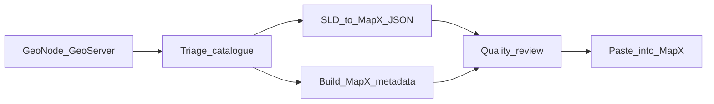

# Sustainable Caucasus → MapX publication

Automated workflow and quality-reviewed artefacts to migrate **Sustainable Caucasus** GeoNode / GeoServer layers into **MapX** (metadata + styles + publication catalogue).

> **Note:** GeoPackage and GeoTIFF source files are **not** included in this repository (≈17 GB). They remain on the project archive / OneDrive. This repo focuses on methodology and MapX-ready JSON/CSV.

## Repository contents

| Path | Description |
|------|-------------|
| `triage/` | Layer characterisation, P1 candidates, publication catalogue |
| `mapx_metadata/` | MapX metadata JSON for each publish layer (+ overrides, QA notes) |
| `mapx_styles/vector/` | MapX style JSON, `.styleinfo.json` paste guides, conversion reports |
| `mapx_rasters/` | Notes for linking raster WMS / legend URLs in MapX |
| `geoserver/` | Exported GeoServer SLD / style metadata (source for style conversion) |
| `*.py` | Automation scripts (catalogue, SLD→JSON, metadata builder, paste guides) |
| `README_geonode_inventory.md` | Longer inventory of the GeoNode VM extraction |

## Methodology



1. **Triage / catalogue** — Score and classify layers; keep publish candidates (P1 + existing MapX views); drop empty/test/broken WMS views. See `triage/publication_catalog.csv`.
2. **Style conversion** — Convert GeoServer SLD to MapX style JSON (`sld_to_mapx_style.py`). Build paste guides with source attribute and rule values (`build_style_paste_guide.py`).
3. **Metadata generation** — Build MapX metadata JSON (`build_mapx_metadata.py`) with titles, abstracts, `keys_m49`, Caucasus bbox, contact, licence, temporal fields (unknown dates → `0001-01-01` + timeless), and attribute aliases.
4. **Quality review** — Spot-checks by data family; fix attribution/keywords/special cases via `_text_overrides.json`; validate form-blocking fields before paste.
5. **MapX publication** — Upload new layers where needed; paste style JSON (+ source attribute for categorical); paste full metadata JSON; use “Update values from source” for precise bbox when available.

## Key scripts

```bash
# From this directory (Python 3)
python triage/characterize_layers.py
python triage/build_publication_catalog.py
python sld_to_mapx_style.py
python build_style_paste_guide.py
python build_mapx_metadata.py
```

## What is excluded

- `database/` (`.gpkg`)
- `rasters/` (`.tif` / `.geotiff`)
- `shapefiles/`

Contact the project team for access to the full spatial archive.

## Licence / citation

Layer licences follow the original data providers (see each metadata JSON `license` and `citation` fields). This repository documents the **publication workflow**, not a redistribution of third-party datasets.
